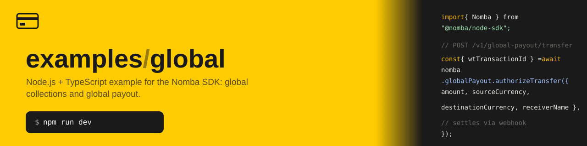

# examples/global

A small Express + TypeScript server for exercising the [`@nomba/node-sdk`](https://developer.nomba.com)'s
**Global Collections** (DRC mobile-money inflows) and **Global Payout**
(multi-currency wallets, FX rates, cross-border transfer and exchange)
products — plus receiving, verifying, and handling the asynchronous
webhooks Nomba sends back about payout settlement.

This is the same app structure as [`examples/webhooks`](../webhooks),
[`examples/bills`](../bills), and [`examples/payments`](../payments) — same
layers (controller → service), same env validation, same logger, same
webhook-verification approach — applied to the global/cross-border side of
the SDK. If you've read
[`examples/webhooks/docs/walkthrough.md`](../webhooks/docs/walkthrough.md),
everything below about *how* the code is organized will already be familiar;
this README covers what's specific to global collections/payout.

Like `payments`, these two products have genuinely different shapes, so each
gets its own module folder:

```
src/modules/
├── collections/
├── payout/
└── webhooks/
```

## Requirements

- **Node.js 24+** — the app runs `.ts` files directly; there is no build step.
  TypeScript is stripped at runtime by Node itself, so no `ts-node`/`tsx` is
  needed. Check with `node --version`.
- A **Nomba sandbox account** with API credentials (account ID, client ID,
  client secret, and a webhook signature key), with Global Collections/Global
  Payout access enabled.
- A **public URL** if you want Nomba to actually deliver webhooks or
  collection callbacks to this server (e.g. [ngrok](https://ngrok.com) or
  [cloudflared](https://developers.cloudflare.com/cloudflare-one/connections/connect-networks/))
  — Nomba can't reach `localhost`.

## Setup

1. Install dependencies:

   ```bash
   npm install
   ```

2. Copy the env template and fill in your sandbox credentials:

   ```bash
   cp .env.example .env
   ```

   | Variable | Required | Default | Description |
   | --- | --- | --- | --- |
   | `PORT` | no | `43905` | Port the HTTP server listens on |
   | `NOMBA_ACCOUNT_ID` | yes | — | Your Nomba parent account ID |
   | `NOMBA_CLIENT_ID` | yes | — | API client ID |
   | `NOMBA_CLIENT_SECRET` | yes | — | API client secret |
   | `NOMBA_ENVIRONMENT` | no | `sandbox` | `sandbox` or `production` — must match your credentials |
   | `NOMBA_WEBHOOK_SECRET` | yes | — | The signature key configured on your webhook subscription; used to verify incoming `/v1/webhooks/nomba` deliveries |
   | `DATABASE_PATH` | no | `./global.db` | Where the local SQLite database file is created — see [Database](#database) |

   Every variable is validated at boot (via `zod` in `src/config/env.config.ts`):
   a missing or malformed value crashes the process immediately with a clear
   error instead of failing later, mid-request.

3. Start the server:

   ```bash
   npm run dev     # restarts on file change (node --watch)
   npm start       # single run, no watch
   ```

On boot the server prints every registered route:

```
[ExampleServer] 12345  - 11/26/2026, 12:00:00 PM     LOG [Bootstrap] Server is running on port 43905
[ExampleServer] 12345  - 11/26/2026, 12:00:00 PM     LOG [Bootstrap] Available routes:
[ExampleServer] 12345  - 11/26/2026, 12:00:00 PM     LOG [Bootstrap]   GET /v1/global-collections/providers
[ExampleServer] 12345  - 11/26/2026, 12:00:00 PM     LOG [Bootstrap]   POST /v1/global-collections/inflows
[ExampleServer] 12345  - 11/26/2026, 12:00:00 PM     LOG [Bootstrap]   GET /v1/global-collections/transactions/:transactionId
[ExampleServer] 12345  - 11/26/2026, 12:00:00 PM     LOG [Bootstrap]   GET /v1/global-payout/accounts
[ExampleServer] 12345  - 11/26/2026, 12:00:00 PM     LOG [Bootstrap]   GET /v1/global-payout/accounts/:accountId
[ExampleServer] 12345  - 11/26/2026, 12:00:00 PM     LOG [Bootstrap]   GET /v1/global-payout/sandbox/accounts
[ExampleServer] 12345  - 11/26/2026, 12:00:00 PM     LOG [Bootstrap]   GET /v1/global-payout/sandbox/accounts/:accountId
[ExampleServer] 12345  - 11/26/2026, 12:00:00 PM     LOG [Bootstrap]   GET /v1/global-payout/exchange-rates
[ExampleServer] 12345  - 11/26/2026, 12:00:00 PM     LOG [Bootstrap]   POST /v1/global-payout/convert
[ExampleServer] 12345  - 11/26/2026, 12:00:00 PM     LOG [Bootstrap]   GET /v1/global-payout/institution-providers
[ExampleServer] 12345  - 11/26/2026, 12:00:00 PM     LOG [Bootstrap]   GET /v1/global-payout/payment-methods
[ExampleServer] 12345  - 11/26/2026, 12:00:00 PM     LOG [Bootstrap]   POST /v1/global-payout/transfer
[ExampleServer] 12345  - 11/26/2026, 12:00:00 PM     LOG [Bootstrap]   POST /v1/global-payout/exchange
[ExampleServer] 12345  - 11/26/2026, 12:00:00 PM     LOG [Bootstrap]   GET /v1/global-payout/transactions/:transactionId
[ExampleServer] 12345  - 11/26/2026, 12:00:00 PM     LOG [Bootstrap]   POST /v1/webhooks/nomba
[ExampleServer] 12345  - 11/26/2026, 12:00:00 PM     LOG [Bootstrap]   POST /v1/webhooks/global-collections
```

Note the default `PORT` (`43905`) differs from the other three examples'
(`43902`/`43903`/`43904`), so you can run all four side by side without a
collision.

4. Verify everything typechecks (recommended before committing):

   ```bash
   npm run typecheck
   ```

## Scripts

| Command | What it does |
| --- | --- |
| `npm start` | Runs the server once (`node --env-file=.env src/main.ts`) |
| `npm run dev` | Same, but restarts on file changes (`node --watch`) |
| `npm run typecheck` | Runs `tsc --noEmit` to check types without compiling |
| `npm run db:generate` | Regenerates the SQL migration in `src/database/migrations/` after editing `src/database/schema.ts` — not needed just to run the app |

## Database

Every inflow and payout gets a row in a local SQLite database
(`DATABASE_PATH`, default `./global.db`), via [drizzle-orm](https://orm.drizzle.team)
on top of Node's built-in `node:sqlite` — no native dependency, no build
step, matching the rest of this project. Everything related to it lives
under `src/database/`:

- `schema.ts` — three tables: `inflows` (one row per `initiateInflow` call,
  keyed by Nomba's own `transactionReference` — there's no caller-chosen
  idempotency key echoed back to key it on instead), `payouts` (one row per
  `authorizeTransfer`/`authorizeExchange` call, keyed by the caller-chosen
  `idempotencyKey`, with `transactionId` — Nomba's `wtTransactionId` — filled
  in once known, and a `type` column distinguishing a transfer row from an
  exchange row), and `webhook_deliveries` (every webhook/callback delivery,
  see below).
- `client.ts` — opens the database and runs any pending migrations from
  `migrations/` on import, so tables exist before the first request. Safe to
  run on every boot.
- `migrations/` — SQL generated by `npm run db:generate`, checked into the
  repo so `npm install && npm run dev` works with no extra step.

**When rows get written:**

- `initiateInflow` inserts an `inflows` row once the SDK call resolves;
  `getInflowTransaction` refreshes it with whatever Nomba says now.
- `authorizeTransfer`/`authorizeExchange` are the two calls with outcome
  hooks (see [Payout outcomes](#payout-outcomes)) — those hooks in
  [`src/common/payout.hooks.ts`](src/common/payout.hooks.ts) persist to
  `payouts`, keyed by `idempotencyKey` since a pending result's
  `wtTransactionId` may not be known yet (same caveat as `BankTransferResult`
  in `examples/webhooks`).
- `getPayoutTransaction` refreshes the matching `payouts` row by
  `transactionId`.
- `handleWebhookEvent` updates a `payouts` row by `transactionId` when a
  `payout_success`/`payout_refund` webhook arrives. Unlike `examples/webhooks`'
  transfer webhooks, a payout webhook carries no merchant-chosen reference to
  fall back to, so if no local row matches, the event is logged (and still
  recorded in `webhook_deliveries`) but not inserted as a new row — this is a
  documented limitation, not a bug, matching the same caveat already called
  out for `examples/payments`' checkout-order correlation.
- The collection-callback handler does a best-effort update of the matching
  `inflows` row by `transactionReference`/`transactionId` — see
  [Webhooks](#webhooks) below for why this one is "best-effort."

**Every webhook/callback delivery is also logged**, independent of whether it
matched a payout or inflow row: `handlePayoutWebhook`/`handleCollectionCallback`
in [`webhook.controller.ts`](src/modules/webhooks/webhook.controller.ts)
write a `webhook_deliveries` row for every request, via `logDelivery` in
[`webhook.service.ts`](src/modules/webhooks/webhook.service.ts). For the
verified route this happens *before* checking the signature, so a rejected
delivery (`signatureValid: false`, `status: 'rejected'`) still leaves a
durable record of exactly what was sent. Once accepted, the row is marked
`status: 'processed'` after the handler runs, or `status: 'failed'` (with the
error message) if it throws.

This is deliberately decoupled from the `payouts`/`inflows` tables: it's
designed so a future **processor** — a separate worker, cron job, or queue
consumer — could poll `webhook_deliveries` for `status = 'received'` rows and
apply them asynchronously, instead of (or alongside) today's synchronous call
inside the request. No code here does that yet; the schema and status
lifecycle just leave room for it without a later migration.

Note: `drizzle-orm`'s `node:sqlite` driver only exists in the `1.0.0-rc.5`
prerelease line as of this writing (the stable `0.45.x` release has no
`node:sqlite` driver yet) — this app pins both `drizzle-orm` and
`drizzle-kit` to that exact version for that reason.

## API reference

All routes are mounted under the `/v1` prefix.

### Global Collections

Prompts a DRC mobile-money customer to approve a charge on their phone
(inflow). Unlike every other product in this project, the initiating call
takes its own per-request `callbackUrl` rather than relying on the shared
Nomba-dashboard webhook subscription — see [Webhooks](#webhooks).

#### `GET /v1/global-collections/providers`

Lists the mobile-money providers available for DRC inflows (pass a `code`
from here as `topupVendor`).

```bash
curl http://localhost:43905/v1/global-collections/providers
```

#### `POST /v1/global-collections/inflows`

Initiates an inflow. Returns `PENDING` immediately — the customer still has
to approve it on their phone; poll or wait for the callback.

```bash
curl -X POST http://localhost:43905/v1/global-collections/inflows \
  -H "Content-Type: application/json" \
  -d '{
    "phoneNumber": "+243800000000",
    "callbackUrl": "https://merchant.example.com/v1/webhooks/global-collections",
    "amount": 5000,
    "currency": "CDF",
    "topupVendor": "MPESA",
    "idempotencyKey": "inflow-2026-0001"
  }'
```

| Field | Type | Rule |
| --- | --- | --- |
| `phoneNumber` | string | required — the customer's mobile money number |
| `callbackUrl` | string | required — must be publicly reachable; see [Webhooks](#webhooks) |
| `amount` | number | required, positive |
| `currency` | string | required, ISO 4217 (e.g. `CDF`) |
| `topupVendor` | string | required — a `code` from `/v1/global-collections/providers` |
| `idempotencyKey` | string | required — the SDK dedupes on it; not echoed back in the result, so it isn't persisted locally |

#### `GET /v1/global-collections/transactions/:transactionId`

Looks up an inflow's current status by the `transactionReference` from
`initiateInflow`'s result.

```bash
curl http://localhost:43905/v1/global-collections/transactions/txn-abc123
```

### Global Payout

Multi-currency wallets, FX rates, and cross-border money movement. Always
check `paymentMethods`/`institutionProviders` for a corridor before calling
`authorizeTransfer` — which fields are required depends on the destination
country and payment method.

#### `GET /v1/global-payout/accounts`

Lists every currency wallet on your account, with balances.

```bash
curl http://localhost:43905/v1/global-payout/accounts
```

#### `GET /v1/global-payout/accounts/:accountId`

Gets one wallet's details and balance.

#### `GET /v1/global-payout/sandbox/accounts` / `GET /v1/global-payout/sandbox/accounts/:accountId`

Same as above, but canned test data from `/v1/sandbox/global-payout/...` —
useful when your sandbox account's real wallets aren't funded. Not a flag on
the live endpoints; a genuinely separate pair of routes.

#### `GET /v1/global-payout/exchange-rates`

Looks up the exchange rate for a currency pair. A calculation only — moves
no money.

```bash
curl "http://localhost:43905/v1/global-payout/exchange-rates?from=USD&to=NGN"
```

| Query param | Type | Rule |
| --- | --- | --- |
| `from` / `to` | string | required, ISO 4217 |
| `region` | string | optional |

#### `POST /v1/global-payout/convert`

Calculates a currency conversion. Also a calculation only — moves no money;
use `/v1/global-payout/exchange` to actually move funds between wallets.

```bash
curl -X POST http://localhost:43905/v1/global-payout/convert \
  -H "Content-Type: application/json" \
  -d '{"amount": 100, "currency": "USD", "destinationCurrency": "NGN", "transactionType": "EXCHANGE"}'
```

#### `GET /v1/global-payout/institution-providers`

Lists receiving institutions (banks/mobile-money providers) available for
payout, optionally filtered.

```bash
curl "http://localhost:43905/v1/global-payout/institution-providers?countryIsoCode=NG&isMobileMoney=false"
```

#### `GET /v1/global-payout/payment-methods`

Lists payment methods available for payout, with their required/optional
fields per corridor when `destinationCountryIsoCode` is given.

```bash
curl "http://localhost:43905/v1/global-payout/payment-methods?destinationCountryIsoCode=NG"
```

#### `POST /v1/global-payout/transfer`

Sends money cross-border to a bank account, mobile-money account, or other
institution. This is one of the two calls in this app that goes through the
SDK's success/pending/failed outcome hooks — see
[Payout outcomes](#payout-outcomes) below.

```bash
curl -X POST http://localhost:43905/v1/global-payout/transfer \
  -H "Content-Type: application/json" \
  -d '{
    "idempotencyKey": "transfer-2026-0001",
    "amount": 100,
    "sourceCurrency": "USD",
    "destinationCurrency": "NGN",
    "receiverName": "Kolapo Ojo",
    "sourceCountryIsoCode": "US",
    "destinationCountryIsoCode": "NG",
    "paymentMethod": "BANK",
    "accountType": "INDIVIDUAL",
    "accountNumber": "0212343456",
    "institutionCode": "101"
  }'
```

| Field | Type | Rule |
| --- | --- | --- |
| `idempotencyKey` | string | required — sent in the body; the API dedupes on it |
| `amount` | number | required, positive |
| `sourceCurrency` / `destinationCurrency` | string | required, ISO 4217 |
| `receiverName` | string | required |
| `sourceCountryIsoCode` / `destinationCountryIsoCode` | string | required, ISO 3166-1 alpha-2 |
| `paymentMethod` | string | required — `BANK`, `MobileMoney`, `INTERAC`, `FASTER_PAYMENTS`, `SEPA`, `ACH`, or `WIRE` |
| `accountType` | string | required — `INDIVIDUAL` or `CORPORATE` |
| `accountNumber` / `institutionCode` / `institutionName` / `bankAccountType` / `purposeOfPayment` / `narration` / `lockedExchangeRateId` / `bankAddress` / `bankCity` / `bankState` / `bankZipCode` / `beneficiary` | — | optional — which are actually required depends on the corridor; check `/v1/global-payout/payment-methods` first |

#### `POST /v1/global-payout/exchange`

Moves money between your own wallets in different currencies. The other call
in this app with outcome hooks.

```bash
curl -X POST http://localhost:43905/v1/global-payout/exchange \
  -H "Content-Type: application/json" \
  -d '{
    "idempotencyKey": "exchange-2026-0001",
    "amount": 100,
    "sourceCurrency": "USD",
    "destinationCurrency": "NGN",
    "senderName": "Acme Ltd",
    "receiverName": "Acme Ltd",
    "sourceCountryIsoCode": "US",
    "destinationCountryIsoCode": "NG"
  }'
```

#### `GET /v1/global-payout/transactions/:transactionId`

Looks up a payout's current status by its `wtTransactionId`.

```bash
curl http://localhost:43905/v1/global-payout/transactions/wt-abc123
```

### `POST /v1/webhooks/nomba`

Where Nomba delivers `payout_success`/`payout_refund` webhook events. Not
meant to be called directly — see [Webhooks](#webhooks) below.

### `POST /v1/webhooks/global-collections`

Where `initiateInflow`'s per-call `callbackUrl` should point. Not meant to be
called directly — see [Webhooks](#webhooks) below.

Every successful response is wrapped the same way:

```json
{
  "message": "Request successful",
  "timestamp": "2026-11-26T12:00:00.000Z",
  "status": "success",
  "data": { "...": "..." }
}
```

and every error the same way, with a status code that matches the failure:

```json
{
  "statusCode": 400,
  "message": "...",
  "error": "Bad Request"
}
```

## Payout outcomes

Of all the calls in this app, only `authorizeTransfer` and
`authorizeExchange` accept the SDK's success/pending/failed outcome hooks —
`initiateInflow` has no such option (see
[Global Collections](#global-collections)); every wallet/rate/lookup call
either succeeds or throws directly. The hooks live in
[`src/common/payout.hooks.ts`](src/common/payout.hooks.ts):

| Outcome | Meaning | What this app does |
| --- | --- | --- |
| `success` | Transfer/exchange settled | Logs it and persists the `payouts` row with the final status and `wtTransactionId` |
| `pending` | Not final — still processing, or an undocumented code | Logs it and persists what's known so far; **wait for the webhook or requery, never retry under a new `idempotencyKey`** — `wtTransactionId` may not be present yet |
| `failed` | A definite rejection | Logs a warning and marks the `payouts` row `failed` |

## Webhooks

This app has two separate inbound routes, because Global Collections and
Global Payout notify you differently:

- **`POST /v1/webhooks/nomba`** — the shared, dashboard-configured webhook
  subscription, verified with the `nomba-signature`/`nomba-timestamp` headers
  against `NOMBA_WEBHOOK_SECRET` via the SDK's `verifyWebhook`, exactly like
  the other three examples. Carries `payout_success`/`payout_refund` events.
  An invalid signature gets a `401` and the event is never processed.
- **`POST /v1/webhooks/global-collections`** — the URL you pass as
  `callbackUrl` on each `initiateInflow` call. The SDK documents no signature
  scheme for this callback, and its payload shape isn't typed anywhere in
  `@nomba/node-sdk`, so this route does **not** verify a signature and parses
  the body best-effort (a parse failure or unrecognized shape is logged and
  swallowed, not thrown) — see the comments in
  [`webhook.service.ts`](src/modules/webhooks/webhook.service.ts). Treat this
  as a convenience for local testing, not a production-hardened integration
  point, until Nomba documents the scheme.

**Important:** both routes need the *raw* request body to be consistent with
how `/v1/webhooks/nomba` must receive it (bytes exactly as Nomba signed
them), so both are mounted behind `express.raw()` instead of the app's normal
`express.json()` — see `src/app.setup.ts`.

To receive real webhooks/callbacks locally:

1. Start a tunnel: `ngrok http 43905` (or your configured `PORT`).
2. In the Nomba dashboard, under **Developer → Webhook Setup**, set the URL
   to `https://<your-tunnel-domain>/v1/webhooks/nomba`, and set the signature
   key to the same value as your `NOMBA_WEBHOOK_SECRET`. Subscribe to
   `payout_success` and `payout_refund`.
3. Pass `https://<your-tunnel-domain>/v1/webhooks/global-collections` as
   `callbackUrl` on each `initiateInflow` call.

## Project structure

```
drizzle.config.ts                 # points drizzle-kit generate at src/database/
src/
├── main.ts                       # entry point
├── app.setup.ts                  # Express app: middleware + route table
├── config/
│   └── env.config.ts             # validated environment variables
├── database/
│   ├── schema.ts                 # drizzle table definitions (3 tables, see Database)
│   ├── client.ts                 # opens the db, runs migrations on import
│   └── migrations/               # generated SQL, checked into the repo
├── common/                       # cross-cutting code
│   ├── logger.ts                 # Nest-style console logger
│   ├── request.logger.ts         # logs every request's method/path/status/duration
│   ├── interceptor.response.ts   # shared success/error JSON envelopes
│   ├── validator.request.ts      # zod-validation middleware factory
│   └── payout.hooks.ts           # success/pending/failed handlers for authorizeTransfer/authorizeExchange
└── modules/                      # one folder per domain
    ├── nomba.ts                  # the shared, configured SDK client
    ├── collections/
    │   ├── collection.controller.ts
    │   └── collection.service.ts
    ├── payout/
    │   ├── payout.controller.ts
    │   └── payout.service.ts
    └── webhooks/
        ├── webhook.controller.ts
        └── webhook.service.ts
```

Each module follows a **controller → service** split: controllers only know
about `req`/`res`, services only know about the Nomba SDK — identical
reasoning to the other three examples. See
[`examples/webhooks/docs/walkthrough.md`](../webhooks/docs/walkthrough.md)
for the full file-by-file explanation and a request trace through every
layer; it applies here unchanged, just with two domain modules instead of
one.

## Logging

Console output is formatted to look like NestJS's default logger (colored
level, pid, timestamp, `[Context]` tag) via the small, dependency-free
`Logger` class in `src/common/logger.ts`. The global error-handling
middleware in `app.setup.ts` logs every unhandled error server-side (method,
path, message, and stack trace) before responding to the client.

Two more things get logged automatically:

- **Every request's timing.** `src/common/request.logger.ts` is mounted
  first in `app.setup.ts`, ahead of both webhook/callback routes' raw-body
  parsing, so it wraps every request including `/health`. It logs
  `METHOD url statusCode durationMs` once the response finishes.
- **The raw webhook/callback payload.** Both webhook handlers log the exact
  bytes received, tagged `[Webhook]`, *before* any processing — so a
  rejected or malformed delivery still leaves a record of what was sent.

## Troubleshooting

| Symptom | Likely cause |
| --- | --- |
| Crash on boot with a Zod error | A required env var is missing — check `.env` against the table above |
| `TokenError` on any `/v1/*` call | Wrong credentials, or `NOMBA_ENVIRONMENT` doesn't match the credential pair (sandbox vs. production) |
| `authorizeTransfer`/`authorizeExchange` rejected with a field-required error | Different corridors require different fields — check `/v1/global-payout/payment-methods?destinationCountryIsoCode=...` first |
| `/v1/webhooks/nomba` always gets `401` | The dashboard's signature key and `NOMBA_WEBHOOK_SECRET` don't match, or you restarted the server after changing `.env` without it picking up the new value |
| `/v1/webhooks/global-collections` never updates an `inflows` row | Its payload shape isn't documented by the SDK — check the logged raw payload (tagged `[Webhook]`) against what `webhook.service.ts`'s `handleCollectionCallback` expects (`transactionReference`/`transactionId` + `status`) and adjust if Nomba's actual shape differs |
| A route 404s | Remember the `/v1` prefix — routes aren't mounted at the bare path |

## License

ISC
